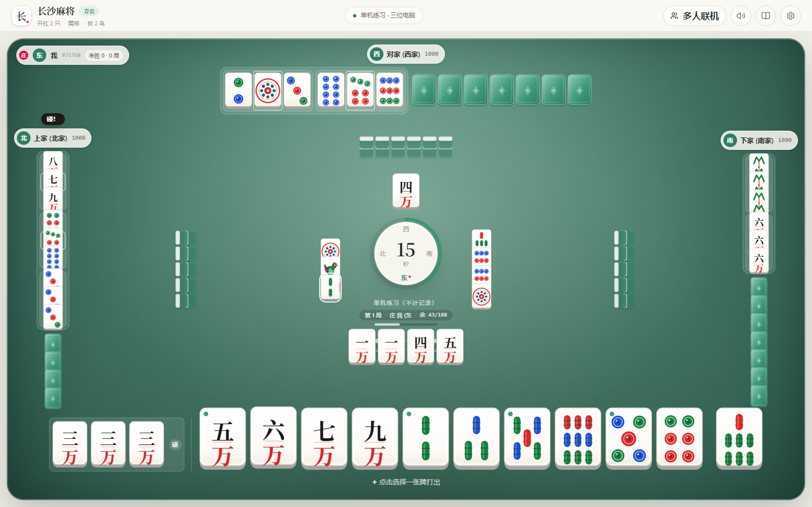
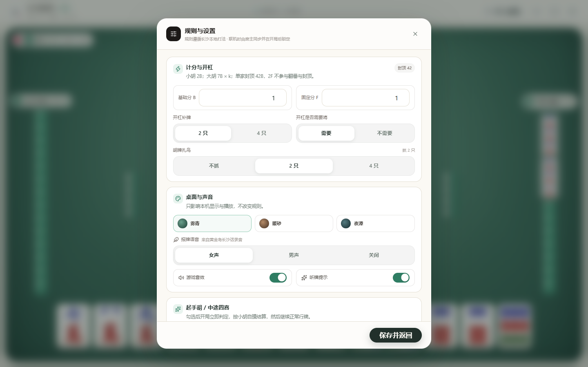
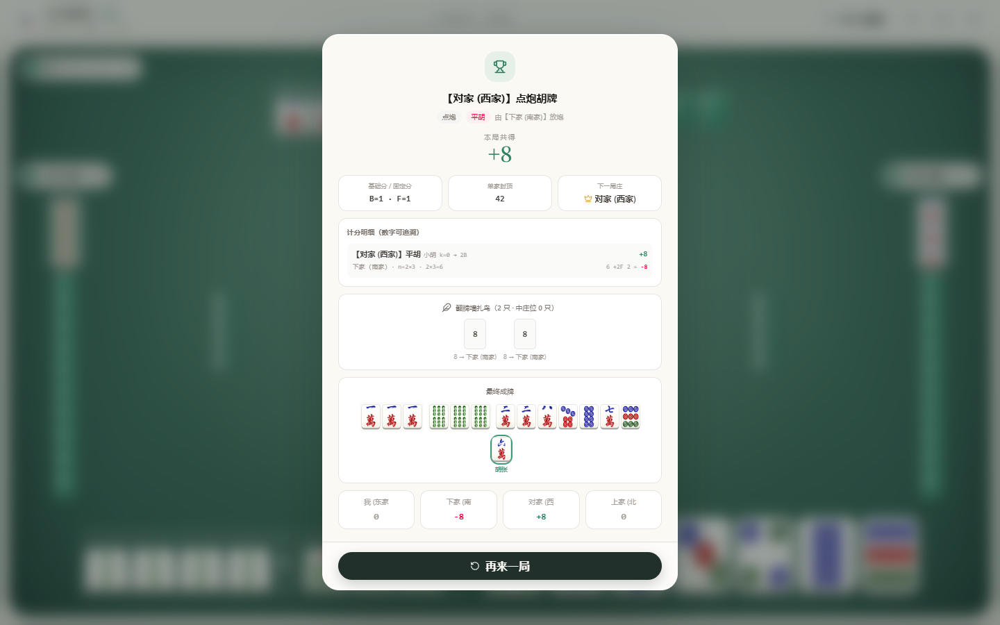

# 长沙麻将 · 青瓷（cs-mahjong）

一款离线可玩、可好友联机的**长沙麻将**网页游戏。界面从《3D 黄金岛》的红金写实风格中抽离出来，重做为
**暖白纸面 + 青瓷毛毡 + 象牙骨牌**的清新版本；牌局规则、番型与算分逻辑保持本地打法不变。

> 设计基线、色板、字号、动效与竖屏约束见 [`docs/DESIGN.md`](docs/DESIGN.md)；
> 计分公式与验算示例见 [`docs/SCORING-RULES.md`](docs/SCORING-RULES.md)；
> 2026-10-18 自测与 BUG 修复记录见 [`docs/BUGFIX-2026-10-18.md`](docs/BUGFIX-2026-10-18.md)；
> 自用 APK / GitHub Pages 见 [`docs/ANDROID.md`](docs/ANDROID.md)。

---

## 🖼 界面预览

| 开局大厅 | 对局中 |
|---|---|
|  |  |

| 设置（含桌面/语音） | 结算 |
|---|---|
|  |  |

更多截图（暖砂 / 夜潭主题、手机竖屏、规则、联机）见 `docs/screenshots/v2/`。

---

## 🌿 这次改版做了什么

### 1. 视觉：从「红金写实」到「瓷白青岚」

- **浅色纸面外壳**：暖白底、细分隔线、低对比阴影，顶栏只保留品牌、模式与四个工具按钮。
- **青瓷毛毡牌桌**：雾青渐变 + 极细经纬织纹 + 一圈很轻的亮边；没有金边、紫晶罗盘和屏幕震动。
- **牌面与黄金岛一致**：27 张牌面（万/条/筒）全部取自 `MJFace2.0-High` 图集；万子是一~九 + 繁体「萬」的毛笔字块，条/筒是原版竹节与圆饼。
- **手牌立起、副露平躺**：手牌保持竖向立体牌身；吃/碰/杠副露绕底边后仰 38°（`rotateX`），看起来是躺在桌面上的牌，和手牌一眼可分。
- **三套桌面**：雾青（默认）/ 暖砂 / 夜潭，只换毛毡色，不改变规则与联机同步。
- **安静的动效**：摸牌 180ms 滑入、出牌落桌、弹窗上浮、碰杠胡小标签 180ms 淡入；没有长时间阻塞与全屏抖动。

### 2. 音声：接入本地《3D 黄金岛》真人长沙话

项目只从本地安装包里提取**少量实际会用到的片段**，输出到 `public/audio/hjd/`：

- 女声 / 男声各一套：1–9 万/条/筒报牌、吃/碰/杠/胡/自摸、长沙番型播报、几句顺口溜。
- 牌桌音效：发牌、落桌、拖动、吃碰杠、胡牌、分数跳动等。
- 设置面板可在「女声 / 男声 / 关闭」之间切换；文件缺失或被浏览器拦截时自动回退到 Web Audio 合成音。

重新提取（需要本机装有 `UnityPy`）：

```bash
pip install UnityPy
python scripts/extract-hjd-audio.py --hjd-root "D:/4a volcano/HJD/3DHJD/3DHJD_Data/StreamingAssets"
```

> 这些音频与万子字块（裁自 HJD `MJFace2.0-High` 牌面图集）来自你提供的《3D 黄金岛》本地文件，
> 仅用于本机/私人项目；若要公开分发，请自行确认授权。

### 3. 规则：一行未改

`src/utils/mahjongLogic.js`、`src/utils/scoring.js`、`src/game/rules.js`、`src/game/priority.js`
等规则/算分/优先级文件保持原样；本次只改 UI、动效、音频与文档。所有规则选项仍在「规则设置」里：

- 开杠补 **2 只 / 4 只**；开杠**需要 / 不需要 258 将**。
- 起手胡（大四喜、板板胡、缺一色、六六顺、中途四喜）与规格外番型可逐项勾选。
- 抓鸟 **0 / 2 / 4** 只，封顶 **42B**，`2F` 不参与翻番与封顶。
- 平胡二五八做将；大胡可乱将，`7B × k` 线性相加。

完整规则说明见 [`docs/RULES.md`](docs/RULES.md)。

---

## 🚀 启动

```bash
npm install
npm run dev
```

打开终端提示的本地地址（默认 `http://localhost:5173`）。生产构建：

```bash
npm run build      # 输出到 dist/，base: './'，可部署到任意子路径
npm run preview
```

## ✅ 测试与门禁

```bash
npm test              # 规则/算分/联机/动效/设计 token 等全部断言
npm run lint:check    # 与 scripts/lint-baseline.txt 比对
npm run secrets:check # 扫 git 跟踪文件中的密钥形态
```

`deploy.yml` 依次跑 `lint:check → secrets:check → test → build`，任一关不过不会发布。

## 🀄 对局与交互约定

- **出牌防误触**：第一次点击只选中；再点同一张需间隔 ≥250ms 才确认；也可以选中后点「打出」。
- **向上拖拽出牌**：按住手牌向上拖过约 52px 直接打出，松手即落桌；短拖/轻点仍走「选中 → 再点」的防误触路径。
- **牌局节奏**：桌心外圈是当前回合倒计时环（≤5 秒转红），下方显示「轮到你出牌 / 某家思考中」；出牌带方向性落桌动效，对手摸牌有轻触声，胡牌有小范围纸屑庆祝。
- **吃碰杠胡大字印章**：任何一家吃/碰/杠/胡/四喜都会在桌心弹出 128px 毛笔大字印章（颜色区分牌型，座位名写在下方），不再依赖小气泡。
- **起手胡座位摊牌**：任何一家起手胡时，不再弹窗拦停；胡家座位前显示只写番型的红色横幅（按座位旋转朝向胡家），并用正面牌替换暗牌、把完整起手牌摊给其余三家看；分数统一到本局结算时落账。
- **放大的操作台**：轮到自己可操作时，手牌上方出现大号操作台：胡 124px、碰/杠/吃/过 104px，带毛笔字与「可操作」级视觉重量；「过」与碰/吃/杠同尺寸的浅灰卡，避免小字误触。
- **刷新回大厅**：对局中刷新会回到大厅，本机战绩/规则/昵称不受影响。
- **结算可追溯**：番型与 k、B/F、逐家中鸟数、封顶前后金额、鸟点/骰子、新庄是谁都会列出来；连庄会标注。
- **本机战绩**：只统计 4 个真人满座、且全程无托管的对局；打电脑不涨。

## 🌐 联机（无需服务器）

- **6 位房间号** + 邀请链接 `?room=XXXXXX&b=N`；端到端加密（PBKDF2-SHA256 → AES-GCM-256）。
- 主/备两条公共 MQTT 通道自动故障转移；手动输号无响应时会换通道重试。
- 断线托管、15 秒出牌兜底、消息去重与乱序丢弃、房间规则同步与开局锁定。
- 网络状况：每 5 秒 PING/PONG，最近 5 次平均延迟显示「45ms 优 / 821ms 差」。

细节见 [`docs/DEPLOY.md`](docs/DEPLOY.md) 与 [`docs/AUDIT.md`](docs/AUDIT.md)。

## 📁 结构速览

```
src/
  App.jsx                 牌局状态机与页面骨架（规则调用，不含规则实现）
  components/             牌张、牌桌、手牌、出牌池、桌心、操作栏、弹窗、开局大厅
  game/                   动作优先级、断线托管、战绩、规则快照
  utils/                  麻将逻辑、算分、AI、联机、加密、音频
  index.css               设计 token（@theme）与全局样式
  mahjong.css             牌桌材质、动效、弹窗通用层
public/audio/hjd/         从本地黄金岛提取的语音/音效（可选）
scripts/extract-hjd-audio.py
docs/                     设计、规则、算分、部署、审计
```
